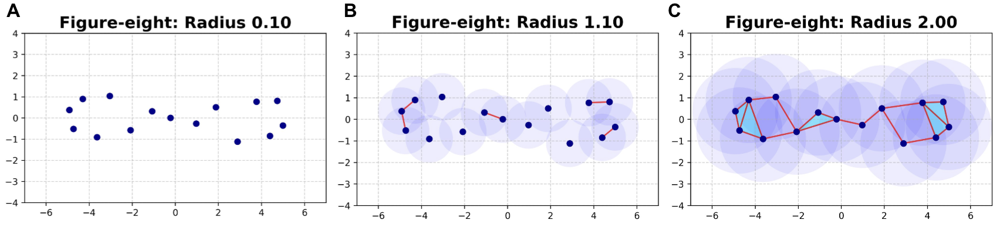
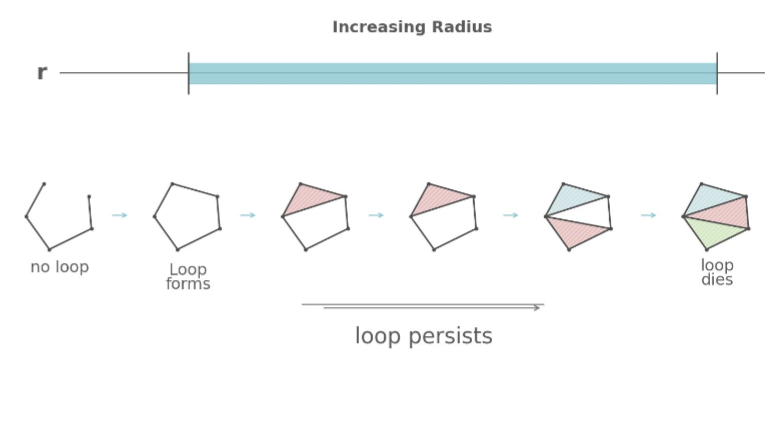
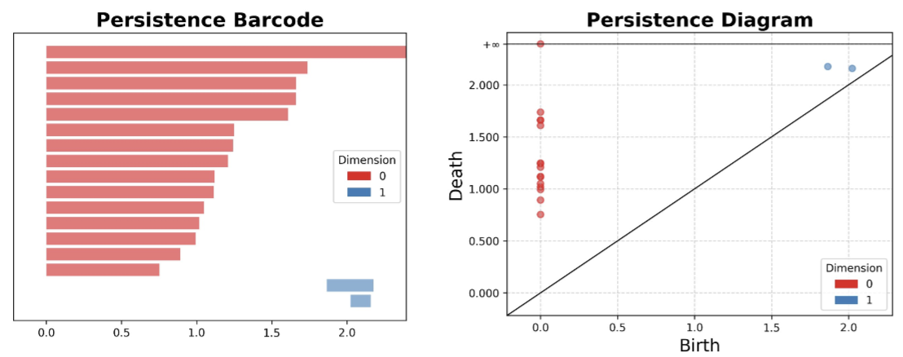
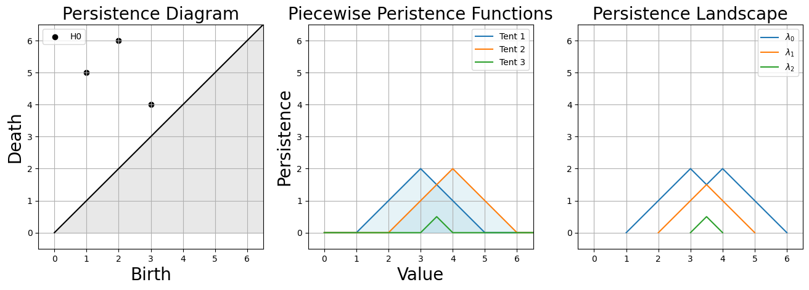
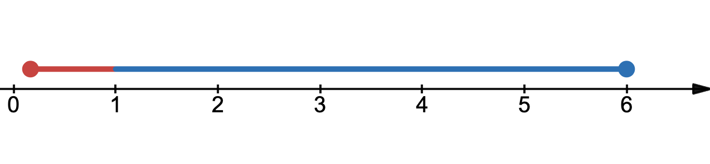
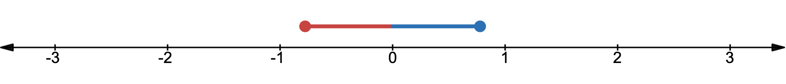
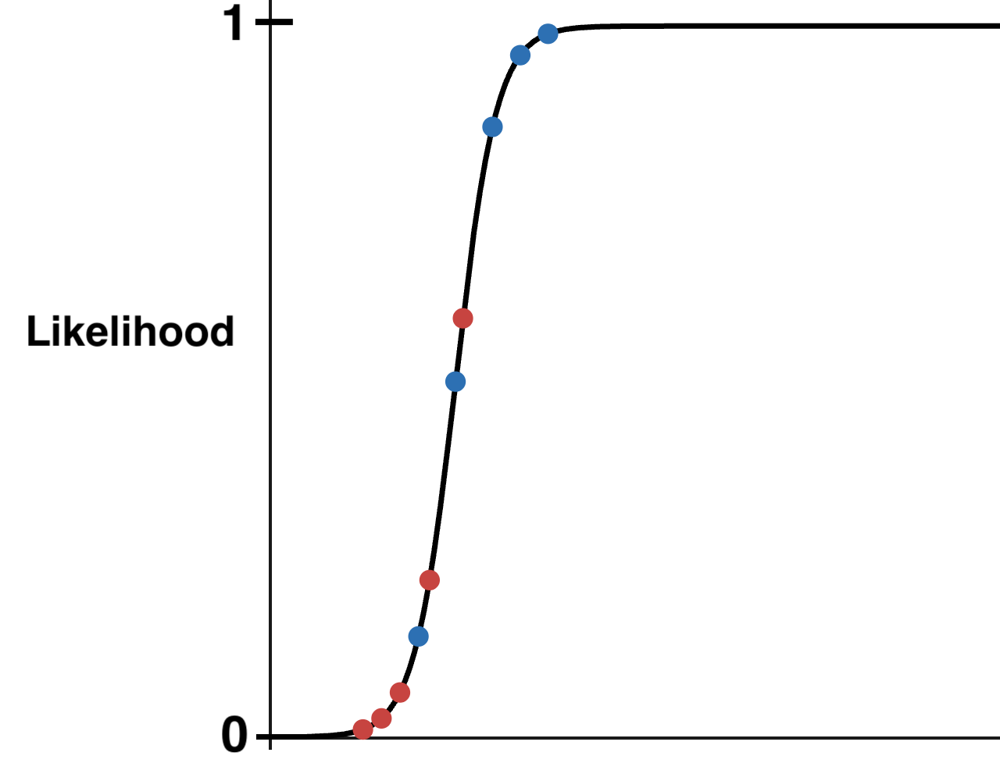

# Topological Data Analysis Overview

Topological Data Analysis (TDA) is an approach of analyzing datasets using techniques from topology.

## Basic Workflow in TDA

Point Cloud $\rightarrow$ Simplicial Complexes $\rightarrow$ Persistence Module $\rightarrow$ Persistence Barcode or Diagram $\rightarrow$ Persistence Landscape

## TDA Key Concepts

**Point Cloud:** a finite set of data points in a metric space. This is the input for TDA.

**Homology:** a method used in topology to identify topological features, such as connected components, $H_0$, holes/loops, $H_1$, and voids, $H_2$. 

**Simplicial Complexes:** a topological space constructed by connecting points, line segments, triangles, and higher-dimensional simplices.

**Persistence Module:** a collection of vector spaces connected by linear maps and tracks the birth and death of topological features. As the radius or distance around a point grows, features appear ("birth") and eventually merge ("death"). 

**Persistence Barcode:** a plot of the lifespan of topological features shown as horizontal line segments. The starting point of each line indicates when the feature appears ("birth") and the endpoint indicates when it merged ("death").

**Persistence Diagram:** an alternative plot to the persistence barcode. Each persistent feature is plotted as a coordinate pair $(b, d) = (birth, death)$ in a 2D plane. 

**Persistence Landscape:** a collection of continuous, piecewise linear functions that summarize a persistence diagram. This representation is more amenable for statistical analysis than the barcodes or diagrams.

## Examples
**Point Cloud $\rightarrow$ Simplicial Complexes**

The process of building simplicial complexes for a figure-eight as the radius parameter increases is shown in the below image.
 \
A. Point cloud of the figure-eight, B. Simplicial complexes begin to form, C. More simplexes are constructed showing higher-dimensional simplexes

**Simplicial Complexes $\rightarrow$ Persistence Barcode and Diagram**

TDA looks for features that stick around across many radii. As the radius parameter increases topological features are born. Once a loop closes up, then it dies. The process of how a loop forms and dies is shown in the below image.

The birth and death of the topological features are represented in persistence barcodes and persistence diagrams. The below image shows the barcode and diagram for the figure-eight point cloud above. The persistence barcode and the persistence diagram show the connected components, $H_0$, in red and the loops, $H_1$, in blue. In the persistence barcode, the longer line segments are features that persist and are more significant, whereas the shorter line segments are features that are born and die quickly and are considered noise. In the persistence diagram, the points that are further above the diagonal, y = x , are features that persist or long-lived and stable, whereas the points clustered very close to the diagonal are features that are short-lived or noise. 

 \

**Persistence Diagram $\rightarrow$ Persistence Landscape**
1. Transform the persistence diagram points
$$(b, d) \xrightarrow{} \left( \frac{b+d}{2}, \frac{d-b}{2} \right)$$

2. Create Piecewise Persistent Functions (also called "peak" or "triangle" or "tent" functions)
$$ \Lambda_p(t)= 
\begin{cases}
t-b & b \leq t \leq \frac{b+d}{2} \\
d-t & \frac{b+d}{2} \leq t \leq d \\
0 & \text{otherwise}
\end{cases} $$

3. Create Persistence Landscape with $\lambda$ Functions
$$\lambda_{dgm}(k, t)= k\max_{\substack{p \, \in \, dgm \\ }} \Lambda_p(t) \quad t \in [0, T], k \in \mathbb{N}$$

- **Example**

    Following the 1-3 steps above for the below example

    

1. Transform the persistence diagram points
$$ p_1 : (1,5) \rightarrow (3,2)
\newline
p_2 : (2,6) \rightarrow (4,2)
\newline
p_3 : (3,4) \rightarrow (3.5,0.5) $$

2. Create Piecewise Persistent Functions (also called "peak" or "triangle" or "tent" functions)
$$ \Lambda_{p_{1}}(t)= 
\begin{cases}
t-1 & 1 \leq t \leq 3 \\
5-t & 3 \leq t \leq 5 \\
0 & \text{otherwise}
\end{cases} $$

$$ \Lambda_{p_{2}}(t)= 
\begin{cases}
t-2 & 2 \leq t \leq 4 \\
6-t & 4 \leq t \leq 6 \\
0 & \text{otherwise}
\end{cases} $$

$$ \Lambda_{p_{3}}(t)= 
\begin{cases}
t-3 & 3 \leq t \leq 3.5 \\
4-t & 3.5 \leq t \leq 4 \\
0 & \text{otherwise}
\end{cases} $$

3. Create Persistence Landscape with $\lambda$ Functions

    Calculate $ \Lambda_{p_{i}}(t) $ for $ t $ values where the slopes change. In this example, we will use $ t= 1, 2, 3, 3.5, 4, 5, 6 $

    For $ \lambda_{0}(t) $ (top landscape layer)
    $$ 
    \begin{aligned}
    & \lambda_{0}(1)= max \{\Lambda_{p_{1}}(1)=0, \Lambda_{p_{2}}(1)=0, \Lambda_{p_{3}}(1)=0\} = 0 \\
    & \lambda_{0}(2)= max \{\Lambda_{p_{1}}(2)=1, \Lambda_{p_{2}}(2)=0, \Lambda_{p_{3}}(2)=0\} = 1 \\
    & \lambda_{0}(3)= max \{\Lambda_{p_{1}}(3)=2, \Lambda_{p_{2}}(3)=1, \Lambda_{p_{3}}(3)=0\} = 2 \\
    & \lambda_{0}(3.5)= max \{\Lambda_{p_{1}}(3.5)=1.5, \Lambda_{p_{2}}(3.5)=1.5, \Lambda_{p_{3}}(3.5)=0.5\} = 1.5 \\
    & \lambda_{0}(4)= max \{\Lambda_{p_{1}}(4)=1, \Lambda_{p_{2}}(4)=2, \Lambda_{p_{3}}(4)=0\} = 2 \\
    & \lambda_{0}(5)= max \{\Lambda_{p_{1}}(5)=0, \Lambda_{p_{2}}(5)=1, \Lambda_{p_{3}}(5)=0\} = 1 \\
    & \lambda_{0}(6)= max \{\Lambda_{p_{1}}(6)=0, \Lambda_{p_{2}}(6)=0, \Lambda_{p_{3}}(6)=0\} = 0 
    \end{aligned}
    $$

    Remove the largest value from each $ \lambda_{0}(t) $ , then find $ \lambda_{1}(t) $
    
    For $ \lambda_{1}(t) $ (middle landscape layer)
    $$ 
    \begin{aligned}
    & \lambda_{1}(1)= max \{\Lambda_{p_{1}}(1)=0, \Lambda_{p_{2}}(1)=0\} = 0 \\
    & \lambda_{1}(2)= max \{\Lambda_{p_{2}}(2)=0, \Lambda_{p_{3}}(2)=0\} = 0 \\
    & \lambda_{1}(3)= max \{\Lambda_{p_{2}}(3)=1, \Lambda_{p_{3}}(3)=0\} = 1 \\
    & \lambda_{1}(3.5)= max \{\Lambda_{p_{1}}(3.5)=1.5, \Lambda_{p_{3}}(3.5)=0.5\} = 1.5 \\
    & \lambda_{1}(4)= max \{\Lambda_{p_{1}}(4)=1, \Lambda_{p_{3}}(4)=0\} = 1 \\
    & \lambda_{1}(5)= max \{\Lambda_{p_{1}}(5)=0, \Lambda_{p_{3}}(5)=0\} = 0 \\
    & \lambda_{1}(6)= max \{\Lambda_{p_{1}}(6)=0, \Lambda_{p_{2}}(6)=0\} = 0 \\
    \end{aligned}
    $$

    Remove the largest value from each $ \lambda_{1}(t) $ , then find $ \lambda_{2}(t) $
    
    For $ \lambda_{2}(t) $ (bottom landscape layer)
    $$
    \begin{aligned}
    & \lambda_{2}(1)= max \{\Lambda_{p_{1}}(1)=0\} = 0 \\
    & \lambda_{2}(2)= max \{\Lambda_{p_{2}}(2)=0\} = 0 \\
    & \lambda_{2}(3)= max \{\Lambda_{p_{3}}(3)=0\} = 0 \\
    & \lambda_{2}(3.5)= max \{\Lambda_{p_{3}}(3.5)=0.5\} = 0.5 \\
    & \lambda_{2}(4)= max \{\Lambda_{p_{3}}(4)=0\} = 0 \\
    & \lambda_{2}(5)= max \{\Lambda_{p_{1}}(5)=0\} = 0 \\
    & \lambda_{2}(6)= max \{\Lambda_{p_{1}}(6)=0\} = 0 \\
    \end{aligned}
    $$

## How to Vectorize Persistence Landscapes for Principal Component Analysis (PCA)

1. **Discretized Values**
    - Choose a fixed grid of points $ t_1, t_2, ... , t_i $ over the range of landscape functions, $ \lambda_{k}(t) $
    - Evaluate $ \lambda_{k}(t) $'s at these points to convert the functional representation into a set of discrete values
    
    $ \star $ This was done for the above **Example** for $ t= 1, 2, 3, 3.5, 4, 5, 6 $ to get the landscape functions $ \lambda_{0}(t) $, $ \lambda_{1}(t) $, $ \lambda_{2}(t) $

    $$
    \begin{aligned}
    & \lambda_{0} \ \text{vector} : [0, 1, 2, 1.5, 2, 1, 0] \\
    & \lambda_{1} \ \text{vector} : [0, 0, 1, 1.5, 1, 0, 0] \\
    & \lambda_{2} \ \text{vector} : [0, 0, 0, 0.5, 0, 0, 0] \\
    \end{aligned}
    $$

2. **Flatten**
    - Concatenate these vectors into a single vector

    $ \star $ Using the same **Example**, we get:

    $$
    \begin{aligned}
    & v = [0, 1, 2, 1.5, 2, 1, 0, 0, 0, 1, 1.5, 1, 0, 0, 0, 0, 0, 0.5, 0, 0, 0] \\
    \end{aligned}
    $$

3. **Standardization**
    - Since different persistence diagrams might give different number of landscape functions, the vectors may have different lengths
    - Identify the max length, W, among ALL the flattened vectors
    - Any shorter vectors pad with zeros, so that the vector has length W

4. **Construct an $ N \times W $ matrix**
    - N is the number of observations or samples

5. **Apply PCA**

## Logistic Regression

**Odds vs Probability**
$$
\begin{array}{c|c}
\text{Odds} & \text{Probability} \\
\hline
\\
\frac{\text{something happening}}{\text{something NOT happening}} & \frac{\text{something happening}}{\text{everything that could happen}} \\
\\
\text{Example:} \ \frac{5 \ \text{games won}}{3 \ \text{games lost}} & \text{Example:} \ \frac{5 \ \text{games won}}{8 \ \text{games total}}
\\
\end{array}
$$

From the Example, we have that there were 5 games won, 3 games lost, and 8 games total.
$$
\begin{aligned}
& \frac{\text{probability of winning}}{\text{probability of not winning}} = \frac{p}{1-p} = \frac{5/8}{3/8} = \frac{5}{3} \
& \text{same as odds} \\
\end{aligned}
$$

Now consider this example,
$$
\begin{array}{c|c}
\text{If the odds are against my team winning 1 to 6} & \text{If the odds are in favor of my team winning 6 to 1} \\
\\
\text{then the odds are} \ \frac{1}{6} = 0.17 & \text{then the odds are} \ \frac{6}{1} = 6
\\
\end{array}
$$

 

The magnitude of the odds against look smaller than the odds in favor. Taking the $log(odds)$ solves this problem by making everything symmetrical.
$$
\begin{array}{c|c}
\text{Odds against} & \text{Odds in favor} \\
\\
log(\frac{1}{6}) = -1.79 & log(\frac{6}{1}) = 1.79
\\
\end{array}
$$

 

**Logit Function** is the log of the ratio of the probabilities.
$$
\begin{aligned}
& log(odds) = log(\frac{p}{1-p}) \\
\end{aligned}
$$

**Linear Regression vs Logistic Regression**

Linear regression is a predictive model where predictions can be less than 0 or greater than 1, resulting in impossible probabilities. Therefore, it is not well suited for classification.
Logistic regression fixes this problem by modeling probabilities that are constrained between 0 and 1.

**Logistic Regression** is  a classification algorithm used when the response variable is categorical, usually two classes (for example, pass/fail, yes/no, control/treatment, etc.).

**Process**

- Transform the y-axis from probability to $log(odds)$

    .png" alt="Image of a logistic function" width="400"> &nbsp;&nbsp;&nbsp;&nbsp;&nbsp;
    log odds.png" alt="Image of transforming probability to log odds" width="400">

    The problem is the transformation pushes the raw data to positive and negative infinity.
    We can not use least squares as is used with linear regression, so we need to use maximum likelihood.

- Project the original data onto the candidate "best fit line". This will give each sample a candidate $log(odds)$ value.

    log odds project to candidate line.png" alt="Image projecting original data onto candidate line" width="400">

- Transform the candidate $log(odds)$ to candidate probabilities
    $$
    \begin{aligned}
    & log(odds) = log(\frac{p}{1-p}) \\
    & e^{log(odds)} = \frac{p}{1-p} \\
    & (1-p) e^{log(odds)} = p \\
    & p + pe^{log(odds)} = e^{log(odds)} \\
    & p(1 + e^{log(odds)}) = e^{log(odds)} \\
    & p = \frac{e^{log(odds)}}{1 + e^{log(odds)}} \\
    \end{aligned}
    $$
    

    The likelihood is the value on the y-axis.
    We take the logs of the probability something happenings (blue points) times the logs of the probability something not happening (red points). Or the $log(likelihood)$.

$$
\begin{aligned}
& log(p_{1}) \times log(p_{2}) \times log(p_{3}) \times log(p_{4}) \times log(p_{5}) \times log(1-p_{6}) \times log(1-p_{7}) \times log(1-p_{8}) \times log(1-p_{9}) \times log(1-p_{10}) \\
& \\
& \text{where} \ p_{1}, ... , p_{5} \ \text{are the blue points and} \ p_{6}, ... , p_{10} \ \text{are the red points} \\
\end{aligned}
$$

- Repeat this process and find the line with the maximum likelihood. That will be the best fit.
    $$
    \begin{aligned}
    & \ell (\beta_{0},\beta_{1}) = \prod_{i: \ y_{i} \ = \ 1} p(x_{i}) \prod_{i': \ y_{i'} \ = \ 0} (1 - p(x_{i'}))
    & \text{Likelihood Function} \\
    & \\
    & \text{where} \ p(x) = \beta_{0} + \beta_{1} x
    \end{aligned}
    $$
